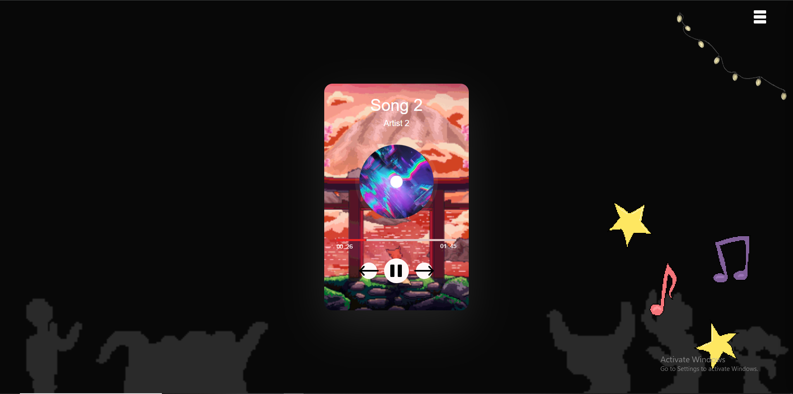
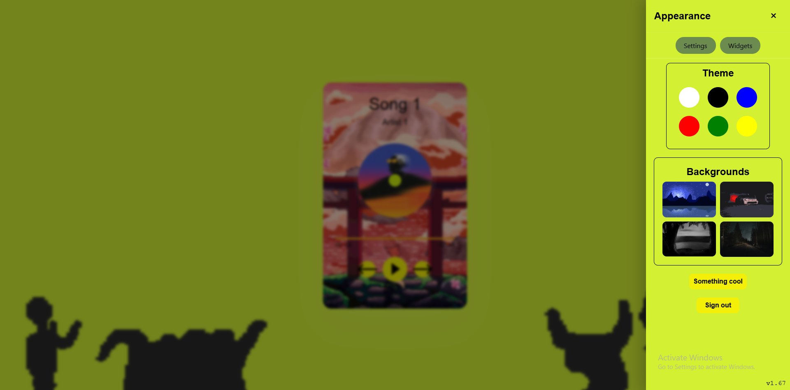
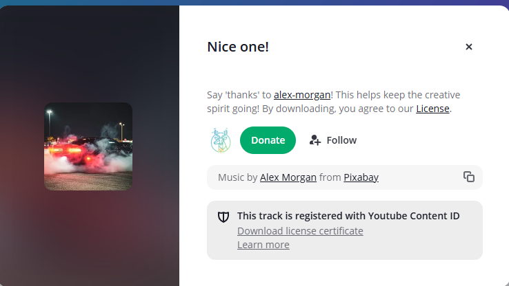
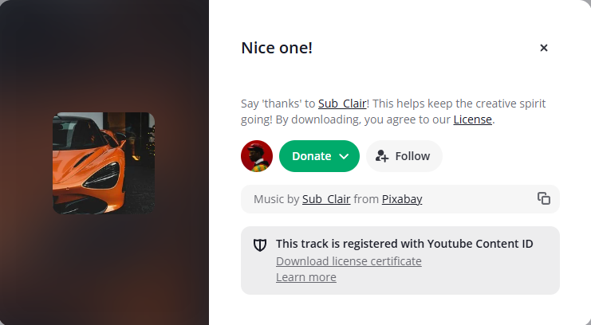
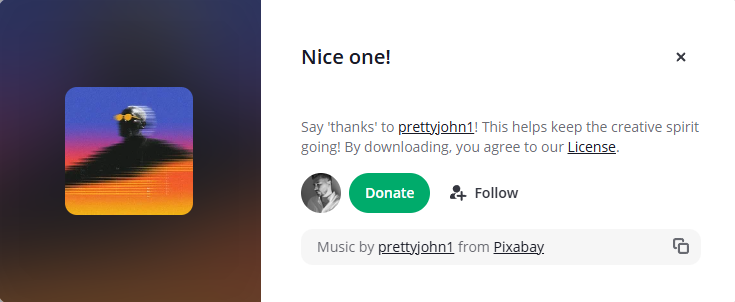
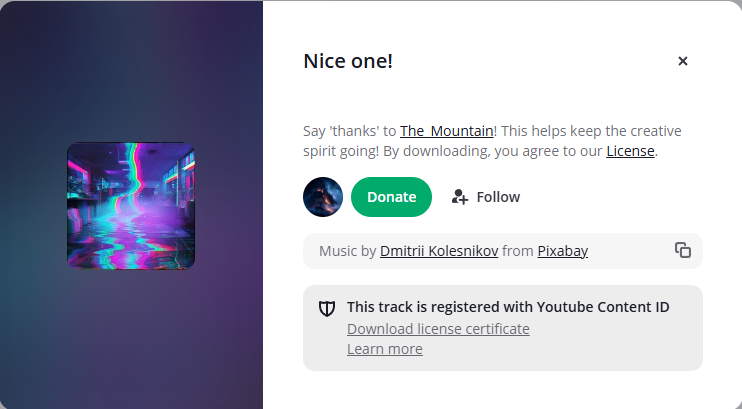
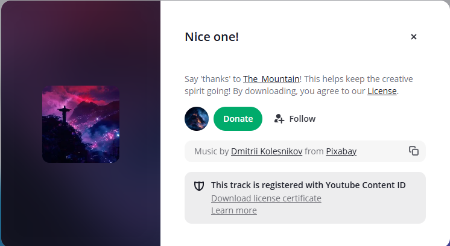

<a id="readme-top"></a>

<!-- HEADER -->
<br />
<div align="center">
	<h1 align="center">Jukebox player</h1>
	<p align="center">
		Introducing Jukebox Player, a website for crazy music lovers to chill out, enjoy music, and feel amazed by the settings.
		<br />
		   You can play cool music here!
		<br />
	</p>
    <br>
    <p>
    Hi, I created this because I wanted to learn more about JavaScript and web development while building something cool and fun to use.
    </p>
</div>

<!-- CONTENTS -->

<details>
    <summary>Table of Contents</summary>
        <li><a href="#about">About The Project</a></li>
        <li><a href="#built-with">Built Using</a></li>
        <li><a href="#getting-started">Getting Started</a></li>
        <li><a href="#credits">Credits</a></li>
        <li><a href="#license">License</a></li>

</details>


## Live Demo

[Open the live website](https://raphelreji.github.io/webmusic-player-trials/)


<!-- ABOUT -->
## About The Project
<br />





This website is made for music lovers who want to chill out and enjoy music.

Here's why:

* A fun website for enjoying music.

* Settings to customize the experience.

* A music-focused interface.

* Built while learning JavaScript and web development.


<p align="right">(<a href="#readme-top">top</a>)</p>

### Built Using
I used the HTML,CSS and js! happy to use these three as i know something<br />
* HTML
* CSS
* JAVASCRIPT

<p align="right">(<a href="#readme-top">top</a>)</p>

<!-- GETTING STARTED -->
## Getting Started
How to download and play this ? It's easy!

### Installation
 you can manually install it, here's how to do it!
1. Clone the repository
	```sh
	git clone https://github.com/RaphelReji/webmusic-player-trials.git
	```
2. Open the project folder in VS Code or any code editor.

3. Open `index.html` in your browser.

<p align="right">(<a href="#readme-top">top</a>)</p>


## Credits
 - icons:Taken from icon8 [Open icon8](https://icons8.com/)
 - used pixabay for images
- musics

 
 
 
 
 

## Research/inspiration

* Thanks to the YouTube tutorial [link](https://youtu.be/Zf_psaJ-wP4?si=CQaxvl83zoJDqgVY) that helped me understand web design and build the base of this project!

<!-- LICENSE -->
## License

Distributed under the MIT License. See `LICENSE` for more information.

<p align="right">(<a href="#readme-top">back to top</a>)</p>

